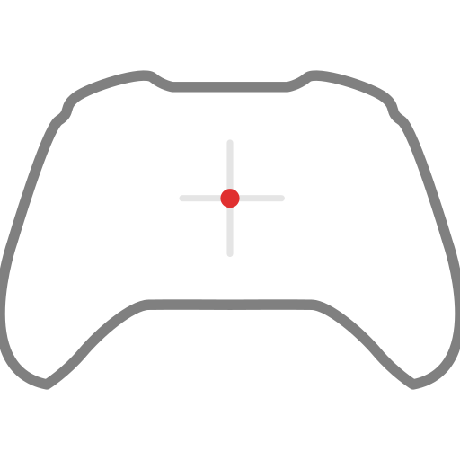

[](https://doi.org/10.5281/zenodo.23536404)




# GCATS
**Gamepad-based Continuous Affect Tracing System**

G-CATS enables the continuous capture of self-reported affective ratings on a dual-axis Cartesian grid using a gamepad thumbstick. It also supports summary ratings within the same session, collected either before or after each stimulus. Images, videos, and audio files can be mixed in a single session. 

> Please look at the guided training protocol to get the raters used to the device and response interface. Link to [GCATS-training](https://github.com/pathakdivya/GCATS-training)

## Install and run from Source Code

Needs Python 3.10+ and a connected gamepad.

```
pip install -r requirements.txt
python run_gcats.py
```

`ffprobe` (from FFmpeg) on your PATH is optional. It only shows media lengths in the Stimuli table.

## Windows Installer

Please use [this link](https://github.com/pathakdivya/GCATS/releases/tag/v.1.0) to download the latest release of the software that includes `GCATS-setup.exe`. Download and double click on it to Install the GCATS app.

## Screenshots
<table width="100%">
<tr>
<td width="33%"></td>
<td width="33%"></td>
<td width="33%"></td>
</tr>
<tr>
<td width="33%"></td>
<td width="33%"></td>
<td width="33%"></td>
</tr>
<tr>
<td width="33%"></td>
<td width="33%"></td>
<td width="33%"></td>
</tr>
</table>


## Running a session

|  | Page | What you do |
|---|---|---|
| 1 | Startup | • Packages are checked automatically<br>• If one is missing, click **Install now** (or run `pip install`), then restart<br>• Plug in the gamepad; its axes and buttons are listed | 
| 2 | Participant | • Enter the ID<br>• Set session, age, gender | 
| 3 | Stimuli | • Choose a file or a folder<br>• Set order, image duration, aspect ratio, margin | 
| 4 | Protocol | • Gap between stimuli: fixation cross or blank screen and select Duration<br>• Rating mode: continuous, summary or both<br>• Summary before or after the stimulus | - |
| 5 | Configuration | • Gamepad Output rate, rating scale, stick mapping<br>• Cursor look, labels<br>• Save or load presets | 
| 6 | Controls | • Pick the thumbstick<br>• Pick the confirm shoulder button |
| 7 | Dead-zone | • Hands off the stick for 3 s<br>• The resting centre and jitter are measured<br>• Measure again if the stick moved |
| 8 | Check | • Move the stick to all four corners<br>• Tick the box if up/down is reversed |

The rating session runs fullscreen. **Escape** stops it early and still saves the data. When it ends, you can run new stimuli for the same participant or quit.

## Display

- The rating grid is a square centred on the media box. 
- Shown on the grid: a faint centre cross, optional guide lines through the cursor, the cursor, and the four end labels. Leave a label blank to hide it.
- **Aspect ratio:** `original` keeps the media size and only shrinks it to fit fullscreen. `1:1`, `3:2`, `4:3` and `16:9` use a fixed shape.
- **Inner margin:** this percentage is kept empty on every side of the screen (default 10%). Helps in clean display during the recording. 
- **Summary screen:** Asks the rator to give a single value on the dual-axis grid. 
- **Audio:** the grid sits in the upper part of the screen with a progress bar below.

## Gamepads Layout and recommended holding style

Axes `0/1` = left stick, `2/3` = right stick. Buttons `4` = left shoulder, `5` = right shoulder. For other layouts, edit `axis_x`, `axis_y`, `btn_confirm` in `gcats/config.py`. Choose between these two holding styles for the rating task, your choice can depend on your handedness or just general comfort levels


## Saving the Data

Saved in folder called `data/` in the app folder (builds if not found):

```
<id>_S<session>_<date>_<time>_raw.csv          every stick reading (about every 4 ms)
<id>_S<session>_<date>_<time>_continuous.csv   one reading per output interval
<id>_S<session>_<date>_<time>_config.json      every setting used
```

Both CSVs have the same columns:

| Column(s) | Meaning |
|---|---|
| `participant_id`, `session`, `trial`, `stimulus_id`, `stimulus_kind` | Who and what |
| `phase` | `trace` (Continuous) or `summary` (Summary Rating) |
| `sample_number`, `t_monotonic`, `stimulus_time` | Row count, clock time, seconds since trial start |
| `raw_x`, `raw_y` | Stick position as the gamepad reports it |
| `mapped_x`, `mapped_y` | After dead-zone and mapping, -1 to 1 |
| `valence`, `arousal` | On your chosen scale |
| `confirm`, `lock` | Shoulder buttons (1 = pressed) |
| `requested_hz`, `achieved_hz`, `sample_interval_s` | Rate you asked for and rate you got |
| `axis_min`, `axis_max`, `joystick_mapping`, `cursor_opacity`, `monitor_refresh`, `*_label` | Settings |

Because raw values are always saved, you can redo the dead-zone, mapping or scale later.

## Troubleshooting

### Common problems

| What you see | What to do |
|---|---|
| The Startup page says "connect a USB gamepad" | Unplug the gamepad and plug it in again. The app looks for it every second |
| A "playback failed" box appears | The video or audio file could not be opened. Check that the file plays in another media player. Check that `ffpyplayer` is installed (`pip install ffpyplayer`) |
| The cursor moves down when you push the stick up | On the Check page, tick the box "Up on the stick sends the cursor down - flip it" |
| The cursor moves when you are not touching the stick | Go to the Dead-zone page and press Measure again. Keep your hands off the stick |
| Dead-zone page says "The stick moved" | Let go of the stick completely and press Measure again |
| Your dead-zone is gone after restarting | This is expected. It is not saved, so measure it again each time you start the app |

### Finding out what went wrong

The app writes a log file you can read, or send to someone for help:

```
C:\Users\<you>\.gcats\gcats.log      (Windows)
~/.gcats/gcats.log                   (macOS / Linux)
```

To get more detail in the log, turn on debug mode before starting the app:

| Where you type it | Command |
|---|---|
| Windows Command Prompt | `set GCATS_DEBUG=1` |
| Windows PowerShell | `$env:GCATS_DEBUG=1` |
| macOS / Linux | `export GCATS_DEBUG=1` |

Then start the app as usual with `python run_gcats.py`.

## Pages

- For how the code is laid out, See [app_design.md](app_design.md).
- For some of the transformations that the Software does, See [feature_loigc.md](feature_logic.md).
- For contributing, See [contributing.md](contributing.md)
- For the detailed wiki with images, See [GCATS wiki](https://github.com/pathakdivya/GCATS/wiki)

## Licence
[GNU GPL-3.0 license](LICENSE)

## Citation (APA)
`Divya Pathak. (2026). pathakdivya/GCATS: GCATS v.1.0 (Version v.1.0) [Computer software]. Zenodo. https://doi.org/10.5281/zenodo.23536404`

Software was built by Divya Pathak at [NSLab](https://sites.google.com/site/ammuns68), [Department of Cognitive Science](https://www.cgs.iitk.ac.in/user/cgs/cgs/), IIT Kanpur.
